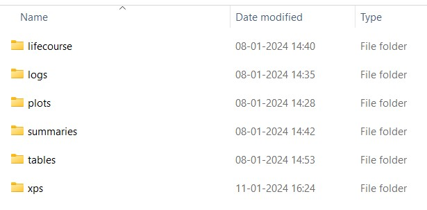

In this vignette, we will run three single-risk-factor scenarios and one that combines them, to demonstrate the sorts of alternative scenarios that can be run in IMPACTncdEngland:

- Reducing BMI by 10% in all simulants compared to their BMI in the baseline scenario (`sc1`)

- Increasing daily fruit & vegetable consumption by 10% compared to consumption in the baseline scenario (`sc2`)

- Increasing physical activity from 0 to 1 day per week for 10% of the simulants who are inactive in the baseline scenario (`sc3`)

- All three changes together (`sc4`)

#### Exposure variables (for primary-prevention scenarios)

A primary-prevention scenario changes these columns of the synthetic population `sp$pop`:

- **active_days_curr_xps** : Number of days of physical activity per week (integer, 0-7)
- **met_curr_xps** : Physical activity in hundreds of MET (metabolic equivalent) minutes per week, derived from `active_days_curr_xps`; update it whenever you change active days (see `sc3`)
- **fruit_curr_xps** : Fruit consumption in grams per day (80g = 1 portion)
- **veg_curr_xps** : Vegetable consumption in grams per day (80g = 1 portion)
- **smok_status_curr_xps** : Current smoking status, a factor with levels `"1"` = never smoker, `"2"` = occasional smoker, `"3"` = ex-smoker, `"4"` = current smoker (assign the level as a character string, e.g. `"1"`)
- **smok_cig_curr_xps** : Cigarettes per day
- **ets_curr_xps** : Exposure to second-hand tobacco smoke. At individual level, 0 = not exposed, 1 = exposed
- **alcohol_curr_xps** : Alcohol consumption in g/day
- **bmi_curr_xps** : Body mass index in kg/m\^2 (BMI)
- **sbp_curr_xps** : Systolic Blood Pressure in mmHg (SBP)
- **tchol_curr_xps** : Total Cholesterol in mmol/L

`sp$pop` also holds smoking history (`smok_quit_yrs_curr_xps`, `smok_dur_curr_xps`) and medication (`bpmed_curr_xps`, `statin_px_curr_xps`) columns.

#### Disease variables (for secondary-prevention scenarios)

The disease names are the `name:` entries under `diseases:` in the design file (apart from the residual `nonmodelled`), and are case-sensitive:

- **obesity** : obesity
- **htn** : hypertension
- **chd** : coronary heart disease (CHD)
- **stroke** : stroke
- **af** : atrial fibrillation
- **hf** : heart failure
- **t2dm** : type 2 diabetes mellitus
- **t1dm** : non-type-2 diabetes mellitus
- **dm** : diabetes mellitus (`t1dm` or `t2dm`)
- **ckd** : chronic kidney disease (stages 3-5)
- **copd** : chronic obstructive pulmonary disease (COPD)
- **asthma** : asthma
- **lung_ca** : lung cancer
- **colorectal_ca** : colorectal cancer
- **prostate_ca** : prostate cancer
- **breast_ca** : breast cancer
- **other_ca** : other cancers
- **cancer** : any of the five cancers above
- **dementia** : dementia
- **andep** : anxiety & depression
- **psychosis** : psychosis
- **epilepsy** : epilepsy
- **alcpr** : alcohol problems
- **helo** : hearing loss
- **ibs** : irritable bowel syndrome
- **constipation** : constipation
- **pain** : chronic pain
- **ra** : rheumatoid arthritis
- **ctd** : connective tissue disorders (excluding rheumatoid arthritis)
- **ctdra** : connective tissue disorders including rheumatoid arthritis (`ctd` or `ra`)

`dm`, `cancer` and `ctdra` are built from their components, and they carry the Cambridge Multimorbidity Score weights of those conditions.

These names are not columns of `sp$pop`. Each disease appears as `<name>_prvl` (0 = free of the condition, above 0 = has it) and as probability columns whose names start with `prb_<name>_` (`_incd` for incidence, `_dgns` for diagnosis, `_mrtl1`/`_mrtl2` for mortality, where the disease has them). None of them exists yet while a primary-prevention scenario runs. To act on them, pass a function of `sp` to `IMPACTncd$update_secondary_prevention_scn()`. It runs after initial prevalence and the disease probabilities have been set and before the simulation engine runs, so `<name>_prvl` still holds the starting state rather than the simulated course of the disease. Call it on its own line: unlike `update_primary_prevention_scn()`, it does not return the simulation object, so it cannot be chained.

For our alternative scenarios, we will set the first year the change starts to 2023.

1. Set up the model as described in the *How to run a test of IMPACTncdEngland* vignette (`how_to_test_run.Rmd`; see [Other files](#other-files)): run `source("global.R")`, make your own design file, download the model data if you have not already, and create the simulation object, e.g. `IMPACTncd <- Simulation$new("./inputs/sim_design_test.yaml")`.

In the design file, you may need to adjust the `n` and `num_chunks` parameters to create the desired synthetic population size. If you use the same `synthpop_dir` location as in your test run, the new synthpop files will have a different filename and will not overwrite the existing files. You may want to delete the old ones to save disk space, but note that `IMPACTncd$del_synthpops()` deletes *everything* in `synthpop_dir`, so never use it on a folder that others share.

Keep the working directory at the root of the repository (the folder that contains `global.R`) throughout. `Simulation$new()` records it, and `run()`, like the other methods that read or write `./inputs` or `./simulation`, stops with an error if the working directory has changed since, naming both folders. This includes a scenario function that calls `setwd()` without changing back. Use `setwd()` to return to the root.

2.  To run a baseline scenario, run the following chunk of code, which deletes everything inside the existing output folder (including the logs) and runs a new baseline scenario from scratch.

```{r, run-simulation, eval = FALSE}
IMPACTncd$
  del_logs()$
  del_outputs()$
  run(mc = 1:2, multicore = FALSE, scenario_nam = "sc0")
```

In the above, we use the chain syntax using $, which is equivalent to:

```{r, run-simulation-break, eval = FALSE}
IMPACTncd$del_logs()
IMPACTncd$del_outputs()
IMPACTncd$run(mc = 1:2, multicore = FALSE, scenario_nam = "sc0")
```

The baseline must be run first, for every iteration you will use in a scenario: each scenario reads its population weights from the baseline's output for the same Monte Carlo iteration (`mc`), and fails if that output is missing.

Note: In the arguments for the `run()`, we have selected the number of Monte Carlo iterations to be 2  (mc = 1:2). This is OK for a test run, but in reality, you would like to run at least 100 iterations (i.e. mc = 1:100) in production. To add iterations later, see [Adding iterations or re-running a scenario](#adding-iterations).

We have also selected `multicore = FALSE` here so that parallel processing is not used. This slows down the simulation, but it requires substantially less computational resources. In production, you would most likely want to set this to TRUE. The third argument of the `run()` function defines the name of the baseline scenario as "sc0" here. Please do not change the name of the baseline scenario.

**Scenario naming convention:** Scenario names should contain only letters, digits, and underscores (e.g. `"sc1"`, `"bmi_reduction_10pc"`). Avoid hyphens, spaces, or other special characters (e.g. do **not** use `"Non-Modelled"` or `"sc 1"`), as these are used internally in SQL identifiers and file paths where special characters can cause errors. `run()` warns about such names.

We do not export summaries yet. `export_summaries()` generates summary files from the lifecourse files, which are the raw simulation output, and it would export these iterations again once they gain more scenarios, so it is quicker to export once, after the last scenario (step 12).

3. After running the code, `output_dir` contains the folders shown below.

```{r, echo = FALSE, out.width = "50%", fig.cap = "Top level of output_dir (with logs: yes and export_xps: yes)"}

```

The raw output is in `lifecourse/`: one `mc=<n>` folder per Monte Carlo iteration and, inside it, one `scenario=<name>` folder per scenario. Each iteration combines `num_chunks` synthetic populations (chunks), and each chunk is written as a parquet dataset named `<chunk>_lifecourse.parquet` (a folder that holds `part-0.parquet`). With the stock `num_chunks: 4`, `mc = 1:2` gives:

```
lifecourse/
├── mc=1/
│   └── scenario=sc0/
│       ├── 1_lifecourse.parquet/
│       ├── 2_lifecourse.parquet/
│       ├── 3_lifecourse.parquet/
│       └── 4_lifecourse.parquet/
└── mc=2/
    └── scenario=sc0/
        ├── 5_lifecourse.parquet/
        ├── ...
        └── 8_lifecourse.parquet/
```

4. After running the baseline scenario, we can run alternative scenarios by registering a scenario function with `update_primary_prevention_scn()` and running the model again under a new scenario name.

In this example, we will simulate a scenario in which the BMI of all simulants is 10% lower than in the baseline scenario, we will start this change in the year 2023, and we will run two iterations (the same as in the baseline scenario above). We store the number of iterations in `n_runs`.

```{r, n-run, eval = FALSE}
n_runs <- 2
```

5. We register the scenario before running it. We start by reducing BMI by 10% for all simulants, for every year from 2023 onwards. In this, `change_10pc` is the size of the change we want to implement in all the scenarios, and `sc_year` is the year from which the change should be implemented.

```{r, scn1, eval = FALSE}
IMPACTncd$update_primary_prevention_scn(
  function(sp) {
    change_10pc <- 0.1
    sc_year <- 23L
    sp$pop[year >= sc_year,
           bmi_curr_xps := bmi_curr_xps * (1 - change_10pc)]
    }
  )
```

The function receives the synthetic population `sp` and edits `sp$pop` in place: a data.table with one row per simulant (`pid`) and year. `year` is stored as two digits, so 2023 is `23L`. Define every constant the function needs inside it, as here. When the function is registered its enclosing environment is replaced, so values captured by a function factory or closure are not visible, and R uses whatever else has that name instead: a global variable (silently), or a function such as `data.table::shift()` (with a confusing error). Keeping each scenario function in a named object (e.g. `sc1_fn <- function(sp) {...}`, then `IMPACTncd$update_primary_prevention_scn(sc1_fn)`) makes it easy to register it again later.

6. Once the scenario is registered we need to run the simulation again as shown below. In this, we use the scenario name `sc1` to represent the scenario we defined above.

We do not export the summaries yet, as we will run more scenarios.

The results from running this scenario are written to their own `scenario=sc1` folders in the lifecourse folder, next to the baseline's.

```{r, run-scn1, eval = FALSE}
IMPACTncd$
  run(1:n_runs, multicore = FALSE, "sc1")
```

7. All subsequent alternative scenarios work in the same way. For example, we can improve fruit and vegetable consumption by 10% in the years greater than or equal to `sc_year`.

Registering a new function replaces the previous one, so in this scenario BMI is as in the baseline scenario.

```{r, sc2, eval = FALSE}
IMPACTncd$update_primary_prevention_scn(
  function(sp) {
    change_10pc <- 0.1
    sc_year <- 23L
    sp$pop[year >= sc_year, fruit_curr_xps := as.integer(round(fruit_curr_xps * (1 + change_10pc)))]
    sp$pop[year >= sc_year, veg_curr_xps := as.integer(round(veg_curr_xps * (1 + change_10pc)))]
    }
  )
```

8. We then run the simulation again; in this, we use the scenario name `sc2` to represent the scenario we defined above.

```{r, run-scn2, eval = FALSE}
IMPACTncd$
  run(1:n_runs, multicore = FALSE, "sc2")
```

9. For physical activity, we will demonstrate a different approach. We will focus only on those people who are inactive in the baseline scenario (0 days of physical activity per week), and for 10% of those people we will increase their physical activity to 1 day per week in every year in which they would otherwise be inactive.

Again, we register a new scenario function. We start by selecting the simulant ids (`pid`) of those who do no physical activity (`active_days_curr_xps` = 0) in at least one year from `sc_year` onwards, and save this as `tt`. Then we use `rbinom()` to randomly select 10% of these people. For them, we set `active_days_curr_xps` to 1 in each year from `sc_year` on in which it is 0; years in which they are already active are left unchanged. We also need to update the `met_curr_xps` variable to reflect the new level of physical activity, using the same formula the model uses to generate it.

The framework already isolates a scenario's random numbers from the rest of the model: it seeds each scenario from its name and iteration, and restores the random-number state afterwards (see [Scenarios share their random numbers with the baseline](#scenarios-share-their-random-numbers-with-the-baseline)). We set our own seed only so that this draw is the same in every scenario that makes it (`sc3` here and `sc4` below). Seeding from the chunk number `sp$mc` also gives each chunk of an iteration its own draws.

```{r, sc3, eval = FALSE}
IMPACTncd$update_primary_prevention_scn(
  function(sp) {
    change_10pc <- 0.1
    sc_year <- 23L
    set.seed(545390654 + sp$mc) # same seed in every scenario that makes this draw
    tt <- sp$pop[year >= sc_year & active_days_curr_xps == 0L, .(unique(pid))]
    tt <- tt[as.logical(rbinom(.N, 1, abs(change_10pc))), V1]
    sp$pop[pid %in% tt & year >= sc_year & active_days_curr_xps == 0L, `:=` (
      active_days_curr_xps = 1L,
      met_curr_xps = as.integer(floor(1 * (3L + qbinom(runif(.N), 8, 3/11)) *
                                        (30 + qexp(runif(.N), 1/7)) / 100))
    )]
  }
)
```

10. We need to run the simulation again; in this, we use the scenario name `sc3` to represent the scenario we defined above.

```{r, run-sc3, eval = FALSE}
IMPACTncd$
  run(1:n_runs, multicore = FALSE, "sc3")
```

11. We now register one function that combines the three changes: BMI, fruit and vegetable intake, and physical activity, for years greater than or equal to `sc_year`, with the size of the change defined by `change_10pc`. The physical-activity part uses the same seed as `sc3`, so it selects the same simulants and makes the same draws.

```{r, sc4, eval = FALSE}
IMPACTncd$update_primary_prevention_scn(
  function(sp) {
    change_10pc <- 0.1
    sc_year <- 23L

    # BMI
    sp$pop[year >= sc_year, bmi_curr_xps := bmi_curr_xps * (1 - change_10pc)]

    # Fr & vg
    sp$pop[year >= sc_year, fruit_curr_xps := as.integer(round(fruit_curr_xps * (1 + change_10pc)))]
    sp$pop[year >= sc_year, veg_curr_xps := as.integer(round(veg_curr_xps * (1 + change_10pc)))]

    # Physical activity (same seed as sc3)
    set.seed(545390654 + sp$mc)
    tt <- sp$pop[year >= sc_year & active_days_curr_xps == 0L, .(unique(pid))]
    tt <- tt[as.logical(rbinom(.N, 1, abs(change_10pc))), V1]
    sp$pop[pid %in% tt & year >= sc_year & active_days_curr_xps == 0L, `:=` (
      active_days_curr_xps = 1L,
      met_curr_xps = as.integer(floor(1 * (3L + qbinom(runif(.N), 8, 3/11)) *
                                        (30 + qexp(runif(.N), 1/7)) / 100))
    )]
  }
)
```

12. We need to run the simulation again; in this, we use the scenario name `sc4` to represent the scenario we defined above.

As this is our final scenario, we will use `export_summaries()` to export summary files into the `summaries` folder in our output directory. For each iteration, it checks whether the existing summaries of every requested type already cover every scenario in that iteration's lifecourse output. If they do, the iteration is skipped; if not, its summaries of the requested types are rewritten, covering all its scenarios.

In this example, we specify the `type` to only export a few of the summary outputs to reduce computation time. We have chosen:

- **dis_char** : disease characteristics, e.g. age of onset of condition, mean duration of condition;

- **prvl** : prevalence of each condition;

- **incd** : incidence of each condition;

- **dis_mrtl** : disease-specific mortality;

- **mrtl** : all-cause mortality;

- **all_cause_mrtl_by_dis** : all-cause mortality by disease;

- **cms** : information on CMS (Cambridge Multimorbidity Score) score and count.

If `type` is not specified, every summary except `contd` is exported (`le`, `hle`, `dis_char`, `prvl`, `incd`, `dis_mrtl`, `mrtl`, `all_cause_mrtl_by_dis`, `cms`, `qalys`, `costs`); `contd` must be named explicitly. An unknown value in `type` is an error. `export_tables()` can build tables only from the summaries that exist, so leave out `type` if you also want, for example, the QALY, cost and life-expectancy tables. A type you add in a later call is exported for every iteration.

```{r, run-sc4, eval = FALSE}
IMPACTncd$
  run(1:n_runs, multicore = FALSE, "sc4") $
    export_summaries(multicore = FALSE, type = c("dis_char", "prvl",
                     "incd", "dis_mrtl", "mrtl",
                     "all_cause_mrtl_by_dis", "cms"))
```

### Adding iterations or re-running a scenario later {#adding-iterations}

You can add iterations to an existing set without deleting the output (do not call `del_outputs()`), e.g. 100 more after a production run of `mc = 1:100`. Run the baseline first and then every scenario for the new iterations. A registered scenario function stays registered until you replace it, and `run()` applies it whatever the scenario name, including `sc0`; so in a session in which you have already registered a scenario, reset it before running the baseline again:

```{r, more-iterations, eval = FALSE}
# Baseline first, with the scenario function reset to "no change"
IMPACTncd$update_primary_prevention_scn(function(sp) NULL)
IMPACTncd$run(101:200, multicore = TRUE, "sc0")

# Then every scenario, registering its function again before each run
IMPACTncd$update_primary_prevention_scn(sc1_fn) # sc1_fn: the function of step 5
IMPACTncd$run(101:200, multicore = TRUE, "sc1")
# ... and likewise for sc2, sc3 and sc4

# Exports only 101-200 if 1-100 already have summaries of every requested type
# (here the default ones); otherwise it exports 1-100 again as well
IMPACTncd$export_summaries(multicore = TRUE)
```

`run()` then reports that output from a previous run of the scenario exists; only iterations with the same numbers are overwritten. A function registered with `update_secondary_prevention_scn()` also stays registered; reset it in the same way with `function(sp) NULL`.

`export_summaries()` re-exports an iteration only when its summaries of a requested type lack one of its scenarios (including when that type has not been exported before). It does not notice that a scenario was re-run, or that the design, the inputs or the model code changed. So:

- if you re-run a scenario under the same name (e.g. after correcting its function), `run()` overwrites that scenario's output for those iterations; call `IMPACTncd$del_summaries()` before `export_summaries()`;
- only add iterations to an existing set if the design file, input data and model version are all unchanged. Otherwise call `IMPACTncd$del_outputs()` and run everything again (and, if you changed an exposure table or a disease-burden input, regenerate the caches as described in [Bring your own exposure distribution tables](#bring-your-own-exposure-distribution-tables)).

### Deprivation-change scenarios: which gradient do you want to move?

A scenario can model a deprivation-*reduction* policy by forcing a simulant's
deprivation, e.g. "everyone moves to the least deprived decile from 2026":

```{r, dep-scn, eval = FALSE}
IMPACTncd$update_primary_prevention_scn(
  function(sp) {
    sc_year <- 26L
    sp$pop[year >= sc_year,
           `:=`(dimd = "10 least deprived", qimd = "5 least deprived")]
    # ... then regenerate the exposures, which are drawn conditional on qimd
  }
)
```

The forced values drive the simulation, but every **output** (lifecourse,
summaries, tables, equity indices, exposure tables) is stratified by each
simulant's **original**, pre-scenario deprivation, so results remain
interpretable as "what happened to the people who started out deprived". That
snapshot-and-restore is automatic.

#### `dimd` and `qimd` are two different channels

The model keys the two halves of the deprivation gradient on **different
variables**, which is what lets you choose between them:

| Variable | What it keys | Channel |
|:---------|:-------------|:--------|
| `qimd` | every exposure distribution table, and the whole smoking sub-model | **modelled** — the risk factors the model represents explicitly |
| `dimd` | the cached PARF table (`p0` background incidence, `m0` background disease mortality), the disease-burden inputs, and stochastic disease duration | **non-modelled** — the part of the gradient the modelled risk factors do *not* explain |

Rewriting `qimd` regenerates each simulant's risk factors from the target
quintile's distributions. Rewriting `dimd` additionally moves their *observed*,
decile-specific background rates. In England the second channel is much the
larger of the two for many outcomes, because the modelled biomarkers carry
little of the deprivation gradient (mean SBP differs by under 1% between the
extreme quintiles, and total cholesterol is slightly *inverse*), while the
non-modelled background risk differs by up to threefold (COPD, psychosis).

#### Choosing, with `parf_deprivation`

`Disease$gen_parf()` runs after your scenario and joins the cached PARF table
onto the population on its natural keys — one of which is `dimd`. So which
decile's background risk each simulant ends up with would otherwise depend on
the order in which the framework happens to call things. It is an explicit
argument instead:

```{r, parf-dep, eval = FALSE}
# "Modelled": only the regenerated exposures act. The non-modelled gradient
# stays as it was. This is the default.
IMPACTncd$update_primary_prevention_scn(my_scenario_fn)
IMPACTncd$run(1:n_runs, multicore = TRUE, "modelled_scn")

# "Non-modelled": the non-modelled gradient moves too, i.e. "as if this person
# had always lived in the target decile" for explained AND unexplained risk.
IMPACTncd$update_primary_prevention_scn(my_scenario_fn,
                                        parf_deprivation = "scenario")
IMPACTncd$run(1:n_runs, multicore = TRUE, "non_modelled_scn")
```

Running the same scenario function under both settings decomposes the total
effect into the part the model's risk factors explain and the part they do not —
which is usually the more interesting result. As in step 5, define the
function's constants inside it rather than building it with a function factory.

The argument has **no effect whatsoever** on a scenario that leaves `dimd`
alone, so you never need to think about it unless you are modelling deprivation
change.

One caveat, so you are not surprised by it. `set_incd_prb()` separately
calibrates incidence to the observed rate at `init_year`, grouped on `dimd`.
If your scenario changes deprivation only from a **future** year onwards, that
calibration is computed on the original deciles and the effect is second-order.
If it rewrites deprivation **at or before `init_year`** (a "change the past"
scenario), the calibration is taken at the forced decile, so incidence is partly
re-calibrated to it whatever `parf_deprivation` says — treat the modelled /
non-modelled split as partial in that case.

### Scenarios share their random numbers with the baseline

The model pairs each scenario with the baseline simulant by simulant: wherever
a scenario leaves a simulant-year alone, that simulant-year receives exactly the
same random numbers as in `sc0` (*common random numbers*; this needs
`kismet: yes` in the design, as in every shipped design). This is what lets a
scenario-minus-baseline contrast be estimated with little Monte Carlo noise. A
direct consequence you can check: a scenario that acts only from `sc_year`
reproduces the baseline lifecourse **exactly**, for every `pid`, in every year
before `sc_year`.

One thing is up to you: **edit `sp$pop` in place.** Do not add, remove,
replace or reorder rows, and keep the table keyed by `pid, year`. Initial
disease prevalence is drawn row by row, so a changed row set would pair
simulants with the wrong draws; `run()` stops with an explanatory error if the
`(pid, year)` of any row differs after your scenario has run. (A
`setkey(sp$pop, pid, year)` on the already-keyed table is harmless.)

Random draws inside a scenario are safe: the framework seeds each scenario from
its name and restores the random-number state afterwards, so they never disturb
the rest of the model. Seed them yourself, as in the physical-activity example
above, only when two differently named scenarios must make the same draws.

Initial prevalence has honoured this pairing only since 2026-10-22 (GitHub
issue #8). Before that, a scenario that changed simulants entering the model
from `sc_year` on re-drew *which* simulants were prevalent in `init_year`, with
the number of cases per stratum unchanged, so pre-`sc_year` years differed from
the baseline. The fix re-draws the initial prevalent cases and their durations
of every disease whose initial prevalence is sampled (incidence type 2 and
above), and the initial diagnosis of every disease whose diagnosis probability
is below 1 (none in the stock design), from statistically equivalent but
different random numbers. Results are therefore **not** bit-comparable with
runs made before it: re-run the baseline together with the scenarios rather
than mixing vintages.

### Other files {#other-files}

The other vignettes are R Markdown files in
`Rpackage/IMPACTncd_England_model_pkg/vignettes/`:

- `how_to_test_run.Rmd` (*How to run a test of IMPACTncdEngland*): setting up
  the model, a baseline test run, and how to remove the model completely;
- `understanding_model_outputs.Rmd`: what the output tables contain and how to
  read them;
- `custom_exposure_tables.Rmd` (*Using your own exposure distribution
  tables*): a worked example for the next section.

`vignette()` (e.g. `vignette("how_to_test_run", package = "IMPACTncdEngland")`)
finds them only if the package was installed with its vignettes built, which
`global.R` does not do.

### Bring your own exposure distribution tables

Every risk factor in `exposure_definitions` (in your `sim_design*.yaml`) points
at a partitioned parquet dataset through its `file_name` key, e.g.:

```yaml
exposure_definitions:
  - name: bmi
    file_name: bmi        # stock table: ./inputs/exposure_distributions/bmi
    var_name: bmi
    # ...
```

You can point any exposure at **your own** table — for example a locality-
specific refit of BMI — without touching the model inputs. `file_name` is
resolved with three rules:

1. **Bare name** (no `/`, e.g. `bmi`) — a stock table shipped with the model at
   `./inputs/exposure_distributions/<name>`. This is the default and is
   unchanged from previous versions.
2. **Relative path containing `/`** (e.g. `tables/bmi_wales` or
   `./bmi_wales`) — resolved **relative to the directory that holds your
   `sim_design*.yaml`**. Ship the parquet dataset next to your scenario files
   and reference it with a relative path.
3. **Absolute path** (`/mnt/.../bmi` or `C:/data/bmi`) — used verbatim. Handy
   for large tables kept on external storage.

Rule 2 is the recommended way to distribute custom tables, and it is what makes
this work **inside the Docker image**: the setup scripts mount your scenario
folder into the container (at `/IMPACTncd_England/scenarios` with
`-ScenariosDir`, or, in standalone mode, with its files linked into
`/IMPACTncd_England`), so a path resolved against the YAML's own directory is
valid both on the host and in the container — no path translation needed. For
example, with this layout:

```
my_scenario/
├── sim_design_my.yaml
├── simulate_my.R
└── tables/
    └── bmi_local/           # your partitioned parquet dataset
        └── part-0.parquet
```

set, in `sim_design_my.yaml`:

```yaml
  - name: bmi
    file_name: tables/bmi_local
    var_name: bmi
    rank_var: rank_bmi
    distribution: continuous
    qfun: fqBCPEo
    join_fn: lookup_dt
    min_value: 14
    max_value: 70
```

The custom table is then used **everywhere** the model reads that exposure —
both when generating the synthetic population and when generating the PARF
starting points — but only when those are generated. The model does not
reliably notice that a table has changed, and can silently reuse caches built
from the previous one:

- synthetic populations are named from 13 design settings (such as `n`,
  `num_chunks`, `ageL` and `ageH`), the locality's LSOAs and a hash of input
  files in `./inputs` (population, mortality and the stock exposure tables).
  Neither `exposure_definitions` nor a table outside `./inputs` is part of
  that name;
- PARFs in `./simulation/parf`, including those downloaded from Zenodo, are
  named from a few design settings and the relative-risk files only.

So before the first `run()` with a new or changed table, regenerate both
caches: call `IMPACTncd$del_parfs()` (it deletes every cached PARF in this copy
of the repository; they are regenerated on the next `run()`), and give the
design its own, empty `synthpop_dir`, or delete the synthpop files built from
the old table. Do not use `IMPACTncd$del_synthpops()` on a shared folder: it
deletes *everything* in `synthpop_dir`. `./simulation/parf` is one cache per
copy of the repository, so call `del_parfs()` again whenever you switch between
designs that use different tables, or keep a separate copy of the repository
for each. Call `del_parfs()` also after you edit a disease-burden input: the
model then reports that the affected PARFs will be regenerated, but removes
only their intermediate `.qs` files.

Your table must have the same schema (join keys plus the relevant distribution
parameters/thresholds) as the stock table it replaces. The simplest way to get
the schema right is to open the stock table (e.g.
`arrow::open_dataset("./inputs/exposure_distributions/bmi")`) and match its
columns. For a continuous exposure this includes `minq` and `maxq`, the
quantile bounds of the `[min_value, max_value]` range. If you change any
distribution parameter, recompute them with the exposure's probability
function (for BMI, whose `min_value` is 14,
`tbl[, minq := fpBCPEo(rep(14, .N), mu, sigma, nu, tau)]`), because the PARF
code reads them straight from the table.
`custom_exposure_tables.Rmd` works through an example.

> **Note:** this mechanism lets you *re-point* the table backing an existing
> exposure. Adding a brand-new exposure *variable* (a new `name`/`var_name` not
> already modelled) additionally requires wiring into the correlation
> structure, relative-risk files, and the simulation engine, and is beyond the
> scope of this vignette.
