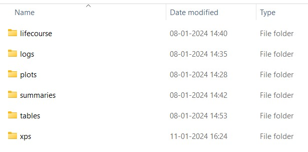

This vignette takes you through a small **baseline test run** from a fresh
copy of the model to a set of output tables. It follows the **native R**
route. If you use the project's Docker images instead (recommended; see the
[README](https://github.com/ChristK/IMPACTncd_Engl#installation)), the data are
already inside the image, so skip [step 3](#step-3-download-the-model-data),
and set up your design file and output folders with
`docker_setup/setup_user_docker_env.sh` as described in
`docker_setup/INSTALLATION_GUIDE.md`.

Before you start, install the prerequisites listed in the README: R (≥ 4.1.0),
**Rtools on Windows** (needed to compile the model's C++ simulation engine)
and, optionally, Git. The model data take about 13 GB once unpacked. While
they are being downloaded you need about as much again for the archives, which
are kept in R's temporary folder (usually on the system drive) and deleted
afterwards. You also need space for the outputs.

## Read this first: the working directory

> **Run every command in this vignette in the R console, or from your own
> script, with the working directory set to the root of the repository** (the
> folder that contains `global.R` and `inputs/`).
>
> **Do not run the code chunk by chunk inside this `.Rmd` file.** RStudio
> evaluates the chunks of an open R Markdown document in the *document's*
> folder (`Rpackage/IMPACTncd_England_model_pkg/vignettes/`). The model finds
> its data through paths such as `./inputs/...`, so they are then looked for
> under `vignettes/` and the run fails
> ([GitHub issue #11](https://github.com/ChristK/IMPACTncd_Engl/issues/11)).
> The model remembers the folder it was set up in. If a later call such as
> `run()` comes from a different folder, it stops straight away with an error
> naming both folders. Run `setwd()` back to the root (the message gives the
> exact command) and call it again.

Check before you begin:

```{r, check-wd, eval = FALSE}
getwd()                 # the repository root, e.g. "C:/IMPACTncd_Engl"
file.exists("global.R") # must be TRUE
```

In RStudio, create a project **in the repository root**: *File → New Project →
Existing Directory*, and choose the root folder. Do not open
`Rpackage/IMPACTncd_England_model_pkg/IMPACTncd_England_model_pkg.Rproj`: that
is the R package's own project and sets the wrong working directory. If you
prefer to run chunks from R Markdown files, set *Tools → Global Options → R
Markdown → Evaluate chunks in directory* to *Project*.

In a terminal, change to the repository root before starting R (type `R` and
press Enter).

## Step 1: set up the R environment

```{r, run-global-r, eval = FALSE}
source("global.R")
```

The first time, `global.R` installs the R packages the model needs, installs
the `CKutils` helper package from GitHub, and compiles and installs the model
package `IMPACTncdEngland`. This can take a while. Later calls are quick: the
model package is only rebuilt when its source code has changed. Run
`source("global.R")` at the start of every R session.

`simulation.R` in the repository root is an example driver script, not a
required step: it runs a baseline and an example scenario with
`multicore = TRUE`. Its last line sources a file that is not in the
repository, so copy the parts you need into your own script rather than
running it as it is.

## Step 2: make your own design file

All settings live in a YAML *design file*. Do not edit the stock
`inputs/sim_design.yaml`: it is tracked by Git, and editing it causes merge
conflicts whenever you update the model. Copy it instead, e.g. to
`inputs/sim_design_test.yaml`, and edit the copy in any text editor.

These are the settings to check for a test run. Leave everything else as it is
unless you know what it does.

| Setting | What it does | Suggested for a test run |
|---|---|---|
| `locality` | The population to simulate: `England` (default), or the exact name of a Local Authority (as spelt in column `LAD17NM`, i.e. 2017 boundaries), a Region (`RGN11NM`, e.g. `North West`) or an Integrated Care Board (`ICB22NM`). A YAML list combines several. | `England` |
| `n` | Number of simulants aged `ageL`–`ageH` in the initial year, per synthetic-population chunk. New `ageL`-year-olds join in every later year on top of this. Stock: 100000. | `2000` |
| `num_chunks` | Number of chunks combined into each Monte Carlo iteration, so the initial population is about `n × num_chunks`. Stock: 4. | `2` |
| `sim_horizon_max` | Last projected year. Keep it at or below 2043: the Local-Authority population projections end there. The model does not check this for you. | `2043` |
| `clusternumber` | Number of CPU cores used in parallel. Allow about 10 GB of free RAM per core. This matters even with `multicore = FALSE` (see step 4). Stock: 20. | `2` |
| `clusternumber_export` | Cores used by `export_summaries()` and `export_tables()`. Exporting can need more memory per core than simulating, so this may need to be lower than `clusternumber`. | `2` |
| `logs` | `yes` keeps a record of the run in `<output_dir>/logs/` (see step 4). | `yes` |
| `export_xps` | `yes` also exports summaries of the exposures (risk factors). This is relatively slow. | `no` for speed |
| `output_dir` | **Absolute** path for the results, e.g. `C:/IMPACTncd_Engl_output/test` on Windows or `/home/me/IMPACTncd_output/test` on Linux. The stock value is a path on the developers' server, so change it. It can grow to hundreds of GB. | your own path |
| `synthpop_dir` | **Absolute** path where the synthetic populations are stored and reused, e.g. `C:/IMPACTncd_Engl_output/synthpop`. Also needs changing; can also grow large. | your own path |

Both folders are created automatically when you create the simulation object
in step 3; an existing folder must be writable. Locality names that do not
match exactly are not reported as an error, so copy them from the lookup file
once the data are downloaded:

```{r, locality-names, eval = FALSE}
lkp <- fst::read_fst("./inputs/pop_estimates_lsoa/lsoa_to_locality_indx.fst",
                     columns = c("LAD17NM", "RGN11NM", "ICB22NM"))
sort(unique(lkp$LAD17NM)) # Local Authority names (2017 boundaries)
```

Authorities created after 2017 (for example Buckinghamshire, or North and West
Northamptonshire) are not recognised; list their 2017 districts instead.

You can keep several design files for different purposes and pass whichever
you need to `Simulation$new()`.

## Step 3: download the model data

The model's input data (about 13 GB) are not stored in Git. They are published
on Zenodo ([10.5281/zenodo.20812409](https://doi.org/10.5281/zenodo.20812409),
CC-BY-SA-4.0) and are downloaded once per copy of the repository. No Zenodo
account or token is needed.

```{r, download-data, eval = FALSE}
IMPACTncd <- Simulation$new("./inputs/sim_design_test.yaml")
IMPACTncd$zenodo_connect()      # the published record; no token needed
IMPACTncd$zenodo_download_all() # inputs and cached model files (~13 GB)
```

On a fresh copy, `Simulation$new()` warns that the exposure data were not
found. That is expected before the download. `zenodo_download_all()` reloads
the object when it finishes, so you can carry straight on. If you skip this
step, the run in step 4 fails with an unhelpful error such as
`object 'active_days' not found`.

The download writes into `./inputs` and `./simulation`, so it too must run from
the repository root. It only adds files that are missing, so running it again
is safe, and it restores any cached file that has been deleted. If the system
drive is short of space, put the temporary archives elsewhere with, e.g.,
`IMPACTncd$zenodo_connect(archive_dir = "D:/zenodo_tmp")` (the folder must
exist). See `vignette("zenodo_data_management")` for details.

## Step 4: run a baseline test

In a new R session, the simulation object is created from your design file
(this is the same call as in step 3; there is no need to repeat it in the
session where you downloaded the data):

```{r, create-simulation-constructor, eval = FALSE}
source("global.R")
IMPACTncd <- Simulation$new("./inputs/sim_design_test.yaml")
```

The following deletes any earlier logs and outputs in `output_dir`, runs two
Monte Carlo iterations of the baseline scenario and summarises them:

```{r, run-simulation, eval = FALSE}
IMPACTncd$
  del_logs()$
  del_outputs()$
  run(mc = 1:2, multicore = FALSE, scenario_nam = "sc0")$
  export_summaries(multicore = FALSE)
```

This uses method chaining with `$`. It is equivalent to:

```{r, run-another-simulation, eval = FALSE}
IMPACTncd$del_logs()
IMPACTncd$del_outputs()
IMPACTncd$run(mc = 1:2, multicore = FALSE, scenario_nam = "sc0")
IMPACTncd$export_summaries(multicore = FALSE)
```

The arguments of `run()`:

- `mc = 1:2` runs Monte Carlo iterations 1 and 2. That is enough for a test;
  in production run at least 100 (`mc = 1:100`).
- `multicore = FALSE` runs the iterations one after another in a single R
  process, which needs much less memory than running them in parallel. In
  production you would normally use `TRUE`. `clusternumber` still matters: it
  sets the number of threads, and the number of helper processes the model
  starts if it has to regenerate its cached population-attributable risk
  fractions (PARFs). With the stock value of 20 that can be too much for a
  laptop, which is why the table above suggests 2.
- `scenario_nam = "sc0"` names the baseline. Do not rename it: other scenarios
  and the output tables are compared with `sc0`.

The first run takes longer than later ones, because the synthetic population
is generated and saved to `synthpop_dir`; later runs with the same settings
reuse it.

With `logs: yes`, what `run()`, `export_summaries()` and `export_tables()`
would print goes to `<output_dir>/logs/console.txt` instead of the screen, so
the console stays quiet while they work. Errors still appear on screen. To
follow progress, open `logs/times.txt` (time stamps for each phase and
iteration) or `logs/console.txt`.

## Step 5: export the output tables

`export_summaries()` writes intermediate summary files. The readable CSV
tables come from `export_tables()`:

```{r, export-tables, eval = FALSE}
IMPACTncd$export_tables(multicore = FALSE, cea = FALSE, equity = FALSE)
```

`cea = FALSE` and `equity = FALSE` are recommended for a baseline-only run.
The cost-effectiveness and equity tables compare a scenario with the baseline,
so with only `sc0` there is nothing to write, but the two tasks would still
load several GB of summaries before finding that out.

## Step 6: look at the outputs

`Simulation$new()` creates these folders in `output_dir`:

```{r, echo = FALSE, out.width = "50%", fig.cap = "Top level of output_dir (with logs: yes and export_xps: yes)"}

```

- `lifecourse/`: the raw simulation output, written by `run()`, one folder
  per iteration and scenario (`mc=<i>/scenario=<name>/`).
- `summaries/`: written by `export_summaries()`.
- `tables/`: the CSV tables, written by `export_tables()`. It is empty until
  you run step 5.
- `xps/`: exposure summaries, written by `run()` when `export_xps: yes`.
- `logs/`: `times.txt`, `console.txt` and one `log<i>.txt` per iteration, when
  `logs: yes`.
- `plots/`: only used by the validation tools.

See `vignette("understanding_model_outputs")` for what the tables contain and
how to read them.

## Running more iterations or scenarios later

`run()` adds new iterations without touching existing ones, provided you do not
call `del_outputs()`. `export_summaries()` then summarises only what is new:
iterations not summarised before, and iterations to which a new scenario has
been added since. Iterations are identified by their number, so any numbering
works:

```{r, more-iterations, eval = FALSE}
IMPACTncd$run(mc = 3:100, multicore = TRUE, scenario_nam = "sc0")
IMPACTncd$export_summaries(multicore = TRUE) # summarises iterations 3 to 100
```

When adding iterations, `run()` reports that output from a previous run of the
scenario already exists. That is expected; only iterations with the same
number would be overwritten.

Only add iterations to an existing set if the model version, input data and
design file are all unchanged; otherwise re-run everything. For the same
reason, `export_summaries()` cannot tell that an existing summary has gone out
of date when its iteration and scenarios are unchanged; after such a change,
start again with `del_outputs()` (see below).

## When you change the design file

After changing anything that affects the results (locality, population size,
horizon, ages, diseases, exposures, …), delete the old outputs with
`IMPACTncd$del_outputs()` before running again. Old raw outputs and summaries
are otherwise reused or mixed with the new ones.

Synthetic populations are named after the settings that define them, so a
changed design generates new ones automatically and never reuses an
incompatible file. Delete old ones only to free disk space, with
`IMPACTncd$del_synthpops()`. That deletes *everything* in `synthpop_dir`, so
never use it on a folder shared with other users.

## Troubleshooting

| Symptom | Likely cause and fix |
|---|---|
| `cannot open file 'global.R'`, or a path containing `.../vignettes/inputs/...` | The working directory is not the repository root; see [Read this first](#read-this-first-the-working-directory). |
| `...: working directory changed since this model was set up` | The model was set up in one folder and is being used from another, typically because code ran inside an `.Rmd`. Run the `setwd()` command the message gives. |
| `object 'active_days' not found` during `run()` | The data have not been downloaded; see [step 3](#step-3-download-the-model-data). |
| `You don't have write access to the output folder` | `output_dir` or `synthpop_dir` points to a folder you cannot write to; change the path or its permissions. |
| The console shows almost nothing for a long time | Normal with `logs: yes`; follow `logs/times.txt` and `logs/console.txt`. |
| R runs out of memory or the computer becomes unresponsive | Lower `clusternumber` and `clusternumber_export`, or use smaller `n`. |

## Removing the model

1. Delete the repository folder. This also removes the downloaded data in
   `inputs/` and `simulation/`.
2. Delete the folders named by `output_dir` and `synthpop_dir` in your design
   file(s).
3. In R, run `remove.packages("IMPACTncdEngland")` and, if no other project
   uses it, `remove.packages("CKutils")`.
4. Docker users: also remove the model images with `docker image rm`.

## Other vignettes

The other vignettes are in `Rpackage/IMPACTncd_England_model_pkg/vignettes/`.
Next, read `how_to_run_scenarios.Rmd` (defining and running policy scenarios)
and `understanding_model_outputs.Rmd` (what the tables mean). You can read the
`.Rmd` files directly, or render them to HTML with `vignettes/build_vignettes.sh`
(this needs pandoc). The `vignette()` function only finds them if the package
was installed with its vignettes built, which `global.R` does not do.

```{r, other-vignettes, eval = FALSE}
vignette("how_to_run_scenarios", package = "IMPACTncdEngland")
vignette("understanding_model_outputs", package = "IMPACTncdEngland")
```
